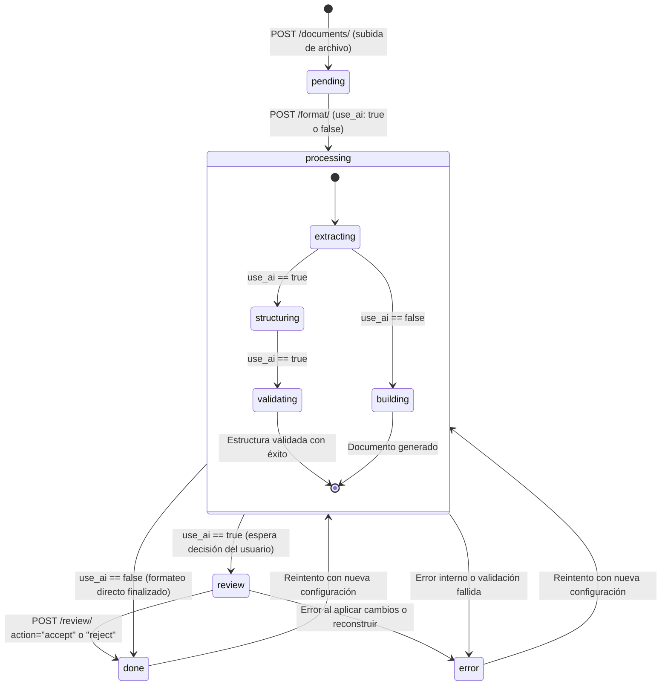

# PrettyDocs — Contrato de API (Sprint 3)

| | |
|---|---|
| **Versión** | 1.1 — borrador para aprobación |
| **Fecha** | 09/11/2026 |
| **Alcance** | Sprint 3: reestructuración inteligente de documentos con IA (títulos, listas, tablas, negritas) y formateo visual asíncrono con revisión |
| **Autores** | Oscar Alejandro Arias Corona, Luis Dorian Ferreira Calderon |
| **Aprobación requerida de** | Alfonso Maron Fernandez Garibay (frontend) y Luis Dorian Ferreira Calderon (backend) |

Este documento es el acuerdo entre frontend y backend. Una vez aprobado, **solo se modifica con acuerdo de ambas partes** y dejando constancia en la sección [Control de cambios](#11-control-de-cambios).

---

## 1. Decisiones del sprint

| Tema | Decisión |
|---|---|
| Modos de procesamiento | **Dos modos:**<br>1. **Sin IA (`use_ai: false`):** Síncrono e *in-place* sobre el original (Sprint 2 sin cambios).<br>2. **Con IA (`use_ai: true`):** Asíncrono mediante `JobRunner`. `POST .../format/` responde `202 Accepted` y el procesamiento continúa en segundo plano con estados de progreso y fase de revisión (`review`). |
| Integridad del documento | **La IA propone estructura, no redacta.** No se corrigen textos, ortografía ni reescritura de oraciones. Un validador de integridad verifica estrictamente por código que la secuencia de palabras y números sea idéntica a la original. |
| Bloques opacos (`keep`) | Imágenes, tablas preexistentes, saltos de sección, ecuaciones y campos se preservan intactos sin ser alterados por la IA. |
| Método de reconstrucción | Con `use_ai: true`, el rebuilder v2 clona el `.docx` original, vacía el cuerpo conservando la última sección (`sectPr`) e inserta los bloques estructurados antes de aplicar las plantillas visuales. |
| Revisión humana | Todo documento procesado con IA pasa por el estado `review` para que el usuario previsualice la estructura propuesta (títulos, listas, tablas, énfasis), pudiendo **aceptar** (con reversiones selectivas por bloque) o **rechazar** (volviendo al formateo sin IA). |
| Unidades | La API recibe y devuelve **centímetros** (márgenes) y **puntos** (tamaño de fuente). El backend realiza las conversiones. |
| Tamaño máximo de archivo | **10 MB** para el archivo `.docx` subido. Para IA, un límite adicional de **60,000 caracteres** de texto extraído. |
| Autenticación | **Ninguna en el Sprint 3.** El backend utiliza un usuario fijo de desarrollo (`dev_user`). |
| Jobs | **Un job activo por documento.** Volver a formatear reemplaza la configuración y reinicia el ciclo del job. |

---

## 2. Convenciones generales

- **URL base (desarrollo):** `http://localhost:8000/api`
- **Origen del frontend permitido por CORS:** `http://localhost:5173`
- **Formato:** JSON en UTF-8, excepto la carga (`multipart/form-data`) y la descarga (flujo binario).
- **Identificadores:** enteros para `document_id` y `job_id`. En las rutas, `{id}` es siempre el **`document_id`**. Los bloques del Documento Intermedio (DI) usan identificadores alfanuméricos estables tipo string (`b1`, `b2`, etc.).
- **Fechas:** ISO 8601 en UTC, por ejemplo `2026-11-09T15:30:00Z`.
- **Nombres de campos:** `snake_case`.
- **Campos sin valor:** se devuelven como `null`, nunca se omiten.

---

## 3. Estados del job

| Estado | Significado |
|---|---|
| `pending` | El documento se cargó y aún no se ha solicitado su formateo. |
| `processing` | El procesamiento está en curso en segundo plano (extrayendo, estructurando con IA, validando o reconstruyendo). |
| `review` | **(Nuevo en Sprint 3)** La IA finalizó la propuesta de estructura y está lista para revisión y vista previa en el frontend. |
| `done` | El documento formateado está listo para descargar. |
| `error` | El procesamiento falló. El código de error está en `error_code` y la descripción en `error_message`. |

### Máquina de estados y transiciones



Transiciones permitidas:
1. `pending → processing → done | error` (cuando `use_ai: false`).
2. `pending → processing → review → done | error` (cuando `use_ai: true`).
3. Si un documento está en `done` o `error`, una nueva petición `POST .../format/` lo regresa a `processing`.
4. Si un documento ya está en `processing`, cualquier intento de iniciar otro formateo o llamar a `/review/` o `/structure/` responderá `409 INVALID_STATE`.

---

## 4. Esquema de configuración

### 4.1 Campos principales

| Campo | Tipo | Obligatorio | Regla |
|---|---|---|---|
| `preset_id` | string \| null | No | Uno de `apa7`, `reporte`, `personalizado`. Si se envía, sus valores se cargan primero. |
| `margins_cm` | objeto | Sí\* | Contiene `top`, `bottom`, `left`, `right`. Cada uno es un número entre **0.5 y 5.0**, con hasta 2 decimales. |
| `font_family` | string | Sí\* | Uno de la [lista cerrada de fuentes](#42-fuentes-permitidas). |
| `font_size_pt` | número | Sí\* | Entre **8 y 24**, en pasos de 0.5. |
| `line_spacing` | número | Sí\* | Entre **1.0 y 3.0**, con hasta 2 decimales. Se aplica como múltiplo. |
| `heading_sizes_pt` | objeto \| null | No | Contiene `h1`, `h2`, `h3`, cada uno entre 8 y 48. Si se omite, se toma del preset o se calcula (ver 4.4). |
| `use_ai` | booleano | No | Activa el motor de estructuración con IA. Por defecto `false`. |
| `ai` | objeto \| null | No | Opciones específicas de IA. Obligatorio o recomendado cuando `use_ai: true`. |

\* **Obligatorio solo si no se envía `preset_id`.** Con `preset_id`, cualquier campo enviado **sobrescribe** el valor del preset.

### 4.2 Fuentes permitidas

`Times New Roman`, `Arial`, `Calibri`, `Cambria`, `Georgia`, `Verdana`

Se usa una lista cerrada para evitar fuentes no disponibles en el entorno de visualización. El valor debe coincidir **exactamente** (mayúsculas y espacios incluidos).

### 4.3 Presets disponibles

| `preset_id` | Nombre | Márgenes (cm) | Fuente | Tamaño | Interlineado | Títulos h1 / h2 / h3 |
|---|---|---|---|---|---|---|
| `apa7` | Formato académico (APA 7) | 2.54 en los 4 lados | Times New Roman | 12 | 2.0 | 12 / 12 / 12 |
| `reporte` | Reporte ejecutivo | 2.5 en los 4 lados | Calibri | 11 | 1.15 | 16 / 14 / 12 |
| `personalizado` | Personalizado | 2.54 en los 4 lados | Calibri | 11 | 1.15 | `null` (se calculan) |

### 4.4 Tamaño de títulos cuando no hay `heading_sizes_pt`

| Título | Factor |
|---|---|
| `h1` (y estilo `Title`) | × 1.5 |
| `h2` | × 1.25 |
| `h3` | × 1.1 |

### 4.5 Sub-objeto de configuración de IA (`ai`)

Cuando `use_ai: true`, se puede enviar la configuración del motor de IA en el objeto `ai`:

| Campo | Tipo | Obligatorio | Por defecto | Valores permitidos / Regla |
|---|---|---|---|---|
| `document_type` | string | No | `"reporte"` | `"reporte"`, `"academico"`, `"acta"`, `"propuesta"`, `"otro"`. Define el contexto para el maquetador de IA. |
| `detect_headings` | booleano | No | `true` | Identifica títulos falsos basados en tamaño, peso y ausencia de punto final. |
| `detect_lists` | booleano | No | `true` | Convierte viñetas con glifos o numeración manual en listas estructuradas de Word. |
| `detect_tables` | booleano | No | `true` | Detecta secuencias de clave-valor o separadores tabulares y los estructura en tablas. |
| `emphasis` | string | No | `"light"` | `"none"`, `"light"`, `"medium"`. Nivel de negritas aplicado a etiquetas y conceptos clave. |

### 4.6 Ejemplo de solicitud sin IA (Sprint 2 compatible)

```json
{
  "preset_id": "apa7",
  "margins_cm": { "left": 3.0 },
  "use_ai": false
}
```

### 4.7 Ejemplo de solicitud con IA (Sprint 3)

```json
{
  "preset_id": "reporte",
  "use_ai": true,
  "ai": {
    "document_type": "reporte",
    "detect_headings": true,
    "detect_lists": true,
    "detect_tables": true,
    "emphasis": "medium"
  }
}
```

---

## 5. Formato de errores

Todo error utiliza la misma estructura unificada:

```json
{
  "error": {
    "code": "INVALID_CONFIG",
    "message": "El tamaño de fuente debe estar entre 8 y 24 pt.",
    "details": { }
  }
}
```

- `code`: identificador alfanumérico estable en mayúsculas, pensado para control de flujo en el frontend.
- `message`: texto descriptivo en español, listo para mostrarse al usuario en la interfaz.
- `details`: objeto opcional con contexto adicional (p. ej. qué campos fallaron o qué bloques generaron conflicto).

### 5.1 Catálogo de errores

| `code` | HTTP | Cuándo ocurre |
|---|---|---|
| `INVALID_FILE` | 400 | El archivo no es un `.docx` válido (extensión incorrecta, firma corrupta, vacío o protegido). |
| `FILE_TOO_LARGE` | 400 | El archivo `.docx` supera el tamaño máximo permitido de 10 MB. |
| `INVALID_CONFIG` | 400 | La configuración está incompleta, fuera de rango o contiene valores no permitidos. |
| `DOCUMENT_TOO_LARGE_FOR_AI` | 400 | **(Nuevo en Sprint 3)** El contenido extraído supera el límite de 60,000 caracteres permitido para procesar con IA. |
| `NOT_FOUND` | 404 | El documento o el preset solicitado no existe. |
| `NOT_READY` | 409 | Se intenta descargar un documento cuyo job aún no está en estado `done`. |
| `INVALID_STATE` | 409 | **(Nuevo en Sprint 3)** La operación solicitada no es válida para el estado actual del job (p. ej., solicitar estructuración mientras ya procesa, o consultar `/structure/` o `/review/` fuera de `review`). |
| `AI_RATE_LIMIT` | 429 | **(Nuevo en Sprint 3)** Se alcanzó la cuota de peticiones o límite de tokens por minuto del proveedor de IA. |
| `PROCESSING_ERROR` | 500 | Falló el formateo interno o la reconstrucción del documento. El job pasa a estado `error`. |
| `AI_NOT_CONFIGURED` | 503 | **(Nuevo en Sprint 3)** El backend no tiene configurada la API key u opciones del proveedor de IA (`AI_API_KEY` ausente). |
| `AI_UNAVAILABLE` | 503 | **(Nuevo en Sprint 3)** El proveedor de IA externo no responde, agotó el timeout o reporta fallas de servicio tras reintentos. |

### 5.2 Detalle de motivos en errores comunes

| `code` | `details.reason` | Mensaje al usuario (`message`) |
|---|---|---|
| `INVALID_FILE` | `no_file` | No se recibió ningún archivo. |
| `INVALID_FILE` | `bad_extension` | Solo se permiten archivos .docx. |
| `INVALID_FILE` | `bad_signature` | El archivo no es un documento de Word válido. |
| `INVALID_FILE` | `cannot_open` | No se pudo abrir el documento. Puede estar dañado o protegido con contraseña. |
| `DOCUMENT_TOO_LARGE_FOR_AI` | `char_limit_exceeded` | El documento excede los 60,000 caracteres de texto plano permitidos para estructuración con IA. |
| `INVALID_STATE` | `already_processing` | El documento ya se encuentra en proceso de formateo. |
| `INVALID_STATE` | `not_in_review` | El documento no está en estado de revisión. |
| `AI_NOT_CONFIGURED` | `missing_key` | El servicio de estructuración con IA no está configurado en el servidor. |
| `AI_UNAVAILABLE` | `timeout_or_5xx` | El servicio de IA no responde en este momento. Intenta de nuevo más tarde o formatea sin IA. |
| `AI_RATE_LIMIT` | `quota_exceeded` | Se ha superado el límite de uso del proveedor de IA. Por favor, espera un momento antes de reintentar. |

---

## 6. Endpoints

### 6.1 Subir documento

`POST /api/documents/`

**Solicitud:** `multipart/form-data`

| Campo | Tipo | Descripción |
|---|---|---|
| `file` | archivo | El archivo `.docx` a procesar (máx. 10 MB). |

**Validaciones:**
1. Archivo presente en la petición.
2. Extensión `.docx`.
3. Tamaño $\le$ 10 MB.
4. Magic bytes de cabecera ZIP (`PK\x03\x04`).
5. Apertura válida con `python-docx`.

**Respuesta exitosa — `201 Created`:**

```json
{
  "document_id": 12,
  "job_id": 12,
  "status": "pending",
  "original_name": "tesis_capitulo1.docx",
  "size_bytes": 248913,
  "uploaded_at": "2026-11-09T15:30:00Z"
}
```

**Errores posibles:** `INVALID_FILE` (400), `FILE_TOO_LARGE` (400).

---

### 6.2 Formatear documento

`POST /api/documents/{id}/format/`

**Solicitud:** `application/json` con el [esquema de configuración](#4-esquema-de-configuración).

**Comportamiento según `use_ai`:**

1. **Si `use_ai: false` (o no se envía):**
   - El procesamiento es **síncrono** (idéntico a Sprint 2).
   - Aplica el formateo *in-place* sobre el documento.
   - Responde inmediatamente con **`200 OK`** y el estado `done`.

2. **Si `use_ai: true`:**
   - Valida la configuración recibida y que el texto no supere 60,000 caracteres.
   - Encola la tarea asíncrona mediante el `JobRunner` del backend.
   - Responde inmediatamente con **`202 Accepted`** indicando que el job pasó a `processing`.
   - Si el job ya se encuentra en `processing`, responde **`409 Conflict`** (`INVALID_STATE`).

**Respuesta exitosa sin IA — `200 OK`:**

```json
{
  "document_id": 12,
  "job_id": 12,
  "status": "done",
  "config": {
    "preset_id": "apa7",
    "margins_cm": { "top": 2.54, "bottom": 2.54, "left": 3.0, "right": 2.54 },
    "font_family": "Times New Roman",
    "font_size_pt": 12.0,
    "line_spacing": 2.0,
    "heading_sizes_pt": { "h1": 12.0, "h2": 12.0, "h3": 12.0 },
    "use_ai": false,
    "ai": null
  },
  "finished_at": "2026-11-09T15:30:04Z"
}
```

**Respuesta exitosa con IA — `202 Accepted`:**

```json
{
  "document_id": 12,
  "job_id": 12,
  "status": "processing",
  "message": "Documento encolado para estructuración con IA."
}
```

**Errores posibles:**
- `NOT_FOUND` (404): el documento no existe.
- `INVALID_CONFIG` (400): configuración incorrecta o incompleta.
- `DOCUMENT_TOO_LARGE_FOR_AI` (400): texto excesivo para el motor de IA.
- `INVALID_STATE` (409): el job ya está en ejecución (`processing`).
- `AI_NOT_CONFIGURED` (503): se solicitó IA pero el servidor no tiene API key configurada.
- `PROCESSING_ERROR` (500): fallo interno inesperado al iniciar el trabajo.

---

### 6.3 Consultar estado del documento

`GET /api/documents/{id}/`

Permite al frontend monitorear el progreso del documento durante el procesamiento asíncrono (*polling* cada 2 segundos).

**Campos agregados en v1.1:**
- `progress`: objeto `{ "stage": string, "done": int, "total": int }` con el avance del pipeline.
  - Etapas posibles en `stage`:
    - `"extracting"`: extrayendo el Documento Intermedio (DI) y calculando señales tipográficas.
    - `"structuring"`: enviando fragmentos al motor de IA / heurístico.
    - `"validating"`: verificando la regla de integridad de tokens y guardrails.
    - `"building"`: reconstruyendo el `.docx` mediante el rebuilder v2 y aplicando plantillas.
- `ai_summary`: objeto con métricas consolidadas de la estructura detectada (o `null` si no aplica).
- `error_code`: código tipificado del error si `status == "error"` (o `null` en caso contrario).

**Respuesta en progreso — `200 OK` (`status: "processing"`):**

```json
{
  "document_id": 12,
  "job_id": 12,
  "original_name": "informe_financiero.docx",
  "size_bytes": 248913,
  "uploaded_at": "2026-11-09T15:30:00Z",
  "status": "processing",
  "progress": {
    "stage": "structuring",
    "done": 3,
    "total": 5
  },
  "ai_summary": null,
  "error_code": null,
  "error_message": null,
  "config": {
    "preset_id": "reporte",
    "use_ai": true,
    "ai": {
      "document_type": "reporte",
      "detect_headings": true,
      "detect_lists": true,
      "detect_tables": true,
      "emphasis": "medium"
    }
  },
  "use_ai": true,
  "started_at": "2026-11-09T15:30:01Z",
  "finished_at": null,
  "download_url": null
}
```

**Respuesta lista para revisión — `200 OK` (`status: "review"`):**

```json
{
  "document_id": 12,
  "job_id": 12,
  "original_name": "informe_financiero.docx",
  "size_bytes": 248913,
  "uploaded_at": "2026-11-09T15:30:00Z",
  "status": "review",
  "progress": {
    "stage": "validating",
    "done": 5,
    "total": 5
  },
  "ai_summary": {
    "headings_detected": 4,
    "lists_detected": 2,
    "tables_detected": 1,
    "bold_emphasis_applied": 14,
    "chunks_total": 5,
    "chunks_fallback": 0,
    "fallback_only": false
  },
  "error_code": null,
  "error_message": null,
  "config": {
    "preset_id": "reporte",
    "use_ai": true,
    "ai": {
      "document_type": "reporte",
      "detect_headings": true,
      "detect_lists": true,
      "detect_tables": true,
      "emphasis": "medium"
    }
  },
  "use_ai": true,
  "started_at": "2026-11-09T15:30:01Z",
  "finished_at": null,
  "download_url": null
}
```

**Respuesta completada — `200 OK` (`status: "done"`):**

```json
{
  "document_id": 12,
  "job_id": 12,
  "original_name": "informe_financiero.docx",
  "size_bytes": 248913,
  "uploaded_at": "2026-11-09T15:30:00Z",
  "status": "done",
  "progress": {
    "stage": "building",
    "done": 5,
    "total": 5
  },
  "ai_summary": {
    "headings_detected": 4,
    "lists_detected": 2,
    "tables_detected": 1,
    "bold_emphasis_applied": 14,
    "chunks_total": 5,
    "chunks_fallback": 0,
    "fallback_only": false,
    "reverted_blocks_count": 0
  },
  "error_code": null,
  "error_message": null,
  "config": {
    "preset_id": "reporte",
    "use_ai": true
  },
  "use_ai": true,
  "started_at": "2026-11-09T15:30:01Z",
  "finished_at": "2026-11-09T15:30:24Z",
  "download_url": "/api/documents/12/download/"
}
```

**Respuesta con error — `200 OK` (`status: "error"`):**

```json
{
  "document_id": 12,
  "job_id": 12,
  "original_name": "informe_financiero.docx",
  "size_bytes": 248913,
  "uploaded_at": "2026-11-09T15:30:00Z",
  "status": "error",
  "progress": null,
  "ai_summary": null,
  "error_code": "AI_UNAVAILABLE",
  "error_message": "El proveedor de IA no responde en este momento tras reintentos. Intenta más tarde o formatea sin IA.",
  "config": { },
  "use_ai": true,
  "started_at": "2026-11-09T15:30:01Z",
  "finished_at": "2026-11-09T15:30:15Z",
  "download_url": null
}
```

**Errores posibles:** `NOT_FOUND` (404).

---

### 6.4 Obtener estructura para revisión (Nuevo en v1.1)

`GET /api/documents/{id}/structure/`

Devuelve el Documento Intermedio (DI) en su versión **original** (extraída) y **propuesta** (estructurada por IA), permitiendo al frontend renderizar la pantalla de revisión y vista previa comparativa de cambios.

> **Restricción:** Este endpoint **solo** responde `200 OK` si el documento está en estado `review`. En cualquier otro estado devuelve `409 INVALID_STATE`.

**Respuesta exitosa — `200 OK`:**

```json
{
  "document_id": 12,
  "job_id": 12,
  "status": "review",
  "original": {
    "schema_version": "di.v1",
    "doc_context": {
      "document_type": "reporte",
      "body_font_size": 11.0
    },
    "blocks": [
      {
        "id": "b1",
        "type": "paragraph",
        "text": "1. RESUMEN EJECUTIVO",
        "runs": [
          { "text": "1. RESUMEN EJECUTIVO", "bold": true }
        ],
        "hints": {
          "all_bold": true,
          "size_ratio": 1.45,
          "words": 3,
          "ends_with_period": false
        }
      },
      {
        "id": "b2",
        "type": "paragraph",
        "text": "• Ventas en la región norte: incremento anual del 15%.",
        "runs": [
          { "text": "• Ventas en la región norte: incremento anual del 15%." }
        ],
        "hints": {
          "starts_with_glyph": "•",
          "indent_level": 0
        }
      },
      {
        "id": "b3",
        "type": "paragraph",
        "text": "Sección de métricas operativas:",
        "runs": [
          { "text": "Sección de métricas operativas:" }
        ],
        "hints": {
          "ends_with_period": false
        }
      },
      {
        "id": "b4",
        "type": "keep"
      }
    ]
  },
  "proposed": {
    "schema_version": "di.v1",
    "blocks": [
      {
        "id": "p1",
        "type": "heading",
        "level": 1,
        "src": ["b1"],
        "runs": [
          { "text": "1. RESUMEN EJECUTIVO" }
        ]
      },
      {
        "id": "p2",
        "type": "list_item",
        "ordered": false,
        "level": 0,
        "src": ["b2"],
        "runs": [
          { "text": "Ventas en la región norte:", "bold": true },
          { "text": " incremento anual del 15%." }
        ]
      },
      {
        "id": "p3",
        "type": "paragraph",
        "src": ["b3"],
        "runs": [
          { "text": "Sección de métricas operativas:" }
        ]
      },
      {
        "id": "p4",
        "type": "keep",
        "src": ["b4"]
      }
    ]
  },
  "summary": {
    "headings_detected": 1,
    "lists_detected": 1,
    "tables_detected": 0,
    "bold_emphasis_applied": 1,
    "revertible_blocks": ["b1", "b2", "b3"]
  }
}
```

**Reglas de los bloques en `proposed`:**
- `type`: uno de `"heading"`, `"paragraph"`, `"list_item"`, `"table"`, `"callout"`, `"keep"`.
- `src`: lista de IDs de bloques del DI original que dieron origen a este bloque estructurado (`["b1"]`, `["b2"]`).
- `level`: nivel jerárquico para `heading` (0 = Título, 1 = H1, 2 = H2, 3 = H3) o nivel de anidación para `list_item` (0 a 2).
- `runs`: lista de fragmentos de texto con propiedades de estilo (`bold`, `italic`, `underline`).
- `keep`: bloques intactos de imágenes, tablas originales o secciones que no fueron alterados.

**Errores posibles:**
- `NOT_FOUND` (404): el documento no existe.
- `INVALID_STATE` (409): el job no está en estado `review` (mensaje: *"El documento no se encuentra en estado de revisión."*).

---

### 6.5 Confirmar revisión y generar documento (Nuevo en v1.1)

`POST /api/documents/{id}/review/`

**Solicitud:** `application/json`

Permite al usuario resolver la etapa de revisión con dos acciones posibles:
1. `action: "accept"`: Aplica la estructura propuesta por la IA, reconstruye el `.docx` con el rebuilder v2 y aplica la plantilla visual. Opcionalmente recibe una lista `revert` con IDs de bloques originales que el usuario decidió **no alterar**.
2. `action: "reject"`: Descarta completamente la reestructuración con IA y aplica únicamente el formateo visual clásico sobre el documento original (flujo Sprint 2).

> **Restricción:** Este endpoint **solo** es válido cuando el documento está en estado `review`.

#### Opción A: Aceptar la propuesta (con bloques revertidos opcionales)

**Cuerpo de la solicitud (`accept`):**

```json
{
  "action": "accept",
  "revert": ["b2"]
}
```

- `action`: obligatorio, valor `"accept"`.
- `revert`: opcional (por defecto `[]`), lista de strings con los IDs de bloques de origen (`src`) que se deben conservar tal cual estaban en el documento original.

**Respuesta exitosa — `200 OK`:**

```json
{
  "document_id": 12,
  "job_id": 12,
  "status": "done",
  "action": "accept",
  "summary": {
    "headings_applied": 1,
    "lists_applied": 0,
    "tables_applied": 0,
    "reverted_blocks_count": 1
  },
  "download_url": "/api/documents/12/download/",
  "finished_at": "2026-11-09T15:30:28Z"
}
```

#### Opción B: Rechazar la propuesta

**Cuerpo de la solicitud (`reject`):**

```json
{
  "action": "reject"
}
```

**Respuesta exitosa — `200 OK`:**

```json
{
  "document_id": 12,
  "job_id": 12,
  "status": "done",
  "action": "reject",
  "summary": {
    "headings_applied": 0,
    "lists_applied": 0,
    "tables_applied": 0,
    "reverted_blocks_count": 0
  },
  "download_url": "/api/documents/12/download/",
  "finished_at": "2026-11-09T15:30:20Z"
}
```

**Errores posibles:**
- `NOT_FOUND` (404): el documento no existe.
- `INVALID_STATE` (409): el job no está en estado `review`.
- `INVALID_CONFIG` (400): el cuerpo de la petición no tiene una acción válida (`accept` o `reject`) o contiene IDs en `revert` que no existen en el DI original.
- `PROCESSING_ERROR` (500): fallo en la reconstrucción del archivo `.docx` o la aplicación de estilos.

---

### 6.6 Descargar documento formateado

`GET /api/documents/{id}/download/`

Descarga el archivo `.docx` procesado y verificado.

> **Restricción:** Solo disponible si el job está en estado `done`. Si se invoca en cualquier otro estado (`pending`, `processing`, `review`, `error`), responde `409 NOT_READY`.

**Respuesta exitosa — `200 OK`:** flujo binario de datos.

| Encabezado | Valor |
|---|---|
| `Content-Type` | `application/vnd.openxmlformats-officedocument.wordprocessingml.document` |
| `Content-Disposition` | `attachment; filename="<nombre_original_sin_extension>_formateado.docx"` |

**Errores posibles:** `NOT_FOUND` (404), `NOT_READY` (409).

---

### 6.7 Listar presets de plantilla

`GET /api/templates/`

**Respuesta exitosa — `200 OK`:**

```json
{
  "presets": [
    {
      "id": "apa7",
      "name": "Formato académico (APA 7)",
      "description": "Times New Roman 12, interlineado doble, márgenes de 2.54 cm.",
      "config": {
        "margins_cm": { "top": 2.54, "bottom": 2.54, "left": 2.54, "right": 2.54 },
        "font_family": "Times New Roman",
        "font_size_pt": 12.0,
        "line_spacing": 2.0,
        "heading_sizes_pt": { "h1": 12.0, "h2": 12.0, "h3": 12.0 }
      }
    },
    {
      "id": "reporte",
      "name": "Reporte ejecutivo",
      "description": "Calibri 11, interlineado 1.15, márgenes de 2.5 cm.",
      "config": {
        "margins_cm": { "top": 2.5, "bottom": 2.5, "left": 2.5, "right": 2.5 },
        "font_family": "Calibri",
        "font_size_pt": 11.0,
        "line_spacing": 1.15,
        "heading_sizes_pt": { "h1": 16.0, "h2": 14.0, "h3": 12.0 }
      }
    },
    {
      "id": "personalizado",
      "name": "Personalizado",
      "description": "Valores base editables.",
      "config": {
        "margins_cm": { "top": 2.54, "bottom": 2.54, "left": 2.54, "right": 2.54 },
        "font_family": "Calibri",
        "font_size_pt": 11.0,
        "line_spacing": 1.15,
        "heading_sizes_pt": null
      }
    }
  ]
}
```

---

## 7. Flujo completo de interacción

### 7.1 Diagrama de interacción con IA (`use_ai: true`)

```
Frontend (Vue 3)                             Backend (API REST + Runner)
   │                                                    │
   │  POST /api/documents/  (archivo .docx)             │
   │ ─────────────────────────────────────────────────► │  Valida ZIP/docx, crea Document y Job
   │ ◄───────────────────────────────────────────────── │  201 Created { document_id: 12, status: "pending" }
   │                                                    │
   │  GET /api/templates/                               │
   │ ─────────────────────────────────────────────────► │
   │ ◄───────────────────────────────────────────────── │  200 OK { presets: [...] }
   │                                                    │
   │  (Usuario activa IA y elige preset/ajustes)        │
   │                                                    │
   │  POST /api/documents/12/format/ (use_ai: true)     │
   │ ─────────────────────────────────────────────────► │  Valida config y encola tarea asíncrona
   │ ◄───────────────────────────────────────────────── │  202 Accepted { status: "processing" }
   │                                                    │
   │  ┌── Polling cada 2s a GET /api/documents/12/ ───┐ │  [Extractor v2 → Chunker → LLM/Heurístico
   │  │                                               │ │   → Validador de Integridad]
   │  │  GET /api/documents/12/                       │ │
   │  │ ────────────────────────────────────────────► │ │
   │  │ ◄──────────────────────────────────────────── │ │  200 OK { status: "processing", progress: {...} }
   │  └── (repite hasta cambiar de estado) ───────────┘ │
   │                                                    │
   │  GET /api/documents/12/                            │
   │ ─────────────────────────────────────────────────► │
   │ ◄───────────────────────────────────────────────── │  200 OK { status: "review", ai_summary: {...} }
   │                                                    │
   │  (Frontend navega a /review/12)                    │
   │                                                    │
   │  GET /api/documents/12/structure/                  │
   │ ─────────────────────────────────────────────────► │
   │ ◄───────────────────────────────────────────────── │  200 OK { original: DI, proposed: DI }
   │                                                    │
   │  (Usuario revisa, revierte bloques o acepta)       │
   │                                                    │
   │  POST /api/documents/12/review/ { action, revert } │
   │ ─────────────────────────────────────────────────► │  Rebuilder v2 + Templates Engine v2
   │ ◄───────────────────────────────────────────────── │  200 OK { status: "done", summary, download_url }
   │                                                    │
   │  (Frontend navega a /result y ofrece descarga)     │
   │                                                    │
   │  GET /api/documents/12/download/                   │
   │ ─────────────────────────────────────────────────► │
   │ ◄───────────────────────────────────────────────── │  200 OK (archivo .docx formateado)
```

### 7.2 Diagrama sin IA (`use_ai: false` — Sprint 2 compatible)

```
Frontend                                     Backend
   │                                            │
   │  POST /api/documents/                      │
   │ ─────────────────────────────────────────► │  201 Created
   │                                            │
   │  POST /api/documents/12/format/            │
   │  (use_ai: false)                           │
   │ ─────────────────────────────────────────► │  Procesa síncronamente in-place
   │ ◄───────────────────────────────────────── │  200 OK { status: "done", config }
   │                                            │
   │  GET /api/documents/12/download/           │
   │ ─────────────────────────────────────────► │  200 OK (archivo .docx)
```

---

## 8. Comportamiento y garantías del motor de IA

1. **Garantía absoluta de contenido:** El motor de IA solo sugiere metadatos de estructura (`heading`, `list_item`, `table`, `callout` y `bold`). La secuencia de palabras y números nunca se altera, añade ni reordena. Si una sugerencia de IA altera el contenido, el validador la rechaza y activa el estructurador heurístico de respaldo.
2. **Defensa contra inyección de instrucciones:** El texto del documento se envía al modelo delimitado como bloque de datos pasivo. Cualquier instrucción contenida en el documento del usuario se ignora por diseño en el prompt del sistema.
3. **Respaldo heurístico automático:** Si el proveedor de IA falla, agota su tiempo de espera o retorna una estructura inválida tras un reintento, el fragmento se resuelve mediante el motor heurístico determinístico (`heuristic.py`). El usuario siempre obtiene un documento válido sin cortes inesperados.

---

## 9. Catálogo de mocks para desarrollo frontend (`VITE_USE_MOCKS=true`)

El frontend puede utilizar las siguientes respuestas simuladas para probar todas las rutas y casos de error.

### 9.1 Mocks de respuestas exitosas

#### Mock 1: Carga de documento exitosa (`POST /api/documents/`)
```json
{
  "document_id": 12,
  "job_id": 12,
  "status": "pending",
  "original_name": "informe_financiero_2026.docx",
  "size_bytes": 154200,
  "uploaded_at": "2026-11-09T15:30:00Z"
}
```

#### Mock 2: Petición de formateo con IA aceptada (`POST /api/documents/12/format/`)
- **Status:** `202 Accepted`
```json
{
  "document_id": 12,
  "job_id": 12,
  "status": "processing",
  "message": "Documento encolado para estructuración con IA."
}
```

#### Mock 3: Petición de formateo sin IA (`POST /api/documents/12/format/`)
- **Status:** `200 OK`
```json
{
  "document_id": 12,
  "job_id": 12,
  "status": "done",
  "config": {
    "preset_id": "reporte",
    "margins_cm": { "top": 2.5, "bottom": 2.5, "left": 2.5, "right": 2.5 },
    "font_family": "Calibri",
    "font_size_pt": 11.0,
    "line_spacing": 1.15,
    "heading_sizes_pt": { "h1": 16.0, "h2": 14.0, "h3": 12.0 },
    "use_ai": false,
    "ai": null
  },
  "finished_at": "2026-11-09T15:30:03Z"
}
```

#### Mock 4: Consulta de estado en progreso (`GET /api/documents/12/`)
- **Status:** `200 OK`
```json
{
  "document_id": 12,
  "job_id": 12,
  "original_name": "informe_financiero_2026.docx",
  "size_bytes": 154200,
  "uploaded_at": "2026-11-09T15:30:00Z",
  "status": "processing",
  "progress": {
    "stage": "structuring",
    "done": 2,
    "total": 4
  },
  "ai_summary": null,
  "error_code": null,
  "error_message": null,
  "config": {
    "preset_id": "reporte",
    "use_ai": true,
    "ai": {
      "document_type": "reporte",
      "detect_headings": true,
      "detect_lists": true,
      "detect_tables": true,
      "emphasis": "light"
    }
  },
  "use_ai": true,
  "started_at": "2026-11-09T15:30:01Z",
  "finished_at": null,
  "download_url": null
}
```

#### Mock 5: Consulta de estado en revisión (`GET /api/documents/12/`)
- **Status:** `200 OK`
```json
{
  "document_id": 12,
  "job_id": 12,
  "original_name": "informe_financiero_2026.docx",
  "size_bytes": 154200,
  "uploaded_at": "2026-11-09T15:30:00Z",
  "status": "review",
  "progress": {
    "stage": "validating",
    "done": 4,
    "total": 4
  },
  "ai_summary": {
    "headings_detected": 3,
    "lists_detected": 2,
    "tables_detected": 1,
    "bold_emphasis_applied": 8,
    "chunks_total": 4,
    "chunks_fallback": 0,
    "fallback_only": false
  },
  "error_code": null,
  "error_message": null,
  "config": {
    "preset_id": "reporte",
    "use_ai": true
  },
  "use_ai": true,
  "started_at": "2026-11-09T15:30:01Z",
  "finished_at": null,
  "download_url": null
}
```

#### Mock 6: Obtener estructura para previsualización (`GET /api/documents/12/structure/`)
- **Status:** `200 OK`
```json
{
  "document_id": 12,
  "job_id": 12,
  "status": "review",
  "original": {
    "schema_version": "di.v1",
    "doc_context": {
      "document_type": "reporte",
      "body_font_size": 11.0
    },
    "blocks": [
      {
        "id": "b1",
        "type": "paragraph",
        "text": "1. OBJETIVOS DEL PROYECTO",
        "runs": [{ "text": "1. OBJETIVOS DEL PROYECTO", "bold": true }],
        "hints": { "all_bold": true, "size_ratio": 1.4, "words": 4, "ends_with_period": false }
      },
      {
        "id": "b2",
        "type": "paragraph",
        "text": "El plan estratégico contempla las siguientes metas prioritarias para el trimestre:",
        "runs": [{ "text": "El plan estratégico contempla las siguientes metas prioritarias para el trimestre:" }],
        "hints": { "all_bold": false, "size_ratio": 1.0, "words": 11, "ends_with_period": false }
      },
      {
        "id": "b3",
        "type": "paragraph",
        "text": "- Optimización de costos: reducción del 12% en compras directas.",
        "runs": [{ "text": "- Optimización de costos: reducción del 12% en compras directas." }],
        "hints": { "starts_with_glyph": "-", "indent_level": 0 }
      },
      {
        "id": "b4",
        "type": "paragraph",
        "text": "- Tiempo de entrega: promedio inferior a 48 horas.",
        "runs": [{ "text": "- Tiempo de entrega: promedio inferior a 48 horas." }],
        "hints": { "starts_with_glyph": "-", "indent_level": 0 }
      },
      {
        "id": "b5",
        "type": "keep"
      }
    ]
  },
  "proposed": {
    "schema_version": "di.v1",
    "blocks": [
      {
        "id": "p1",
        "type": "heading",
        "level": 1,
        "src": ["b1"],
        "runs": [{ "text": "1. OBJETIVOS DEL PROYECTO" }]
      },
      {
        "id": "p2",
        "type": "paragraph",
        "src": ["b2"],
        "runs": [{ "text": "El plan estratégico contempla las siguientes metas prioritarias para el trimestre:" }]
      },
      {
        "id": "p3",
        "type": "list_item",
        "ordered": false,
        "level": 0,
        "src": ["b3"],
        "runs": [
          { "text": "Optimización de costos:", "bold": true },
          { "text": " reducción del 12% en compras directas." }
        ]
      },
      {
        "id": "p4",
        "type": "list_item",
        "ordered": false,
        "level": 0,
        "src": ["b4"],
        "runs": [
          { "text": "Tiempo de entrega:", "bold": true },
          { "text": " promedio inferior a 48 horas." }
        ]
      },
      {
        "id": "p5",
        "type": "keep",
        "src": ["b5"]
      }
    ]
  },
  "summary": {
    "headings_detected": 1,
    "lists_detected": 2,
    "tables_detected": 0,
    "bold_emphasis_applied": 2,
    "revertible_blocks": ["b1", "b3", "b4"]
  }
}
```

#### Mock 7: Confirmar revisión con aceptación (`POST /api/documents/12/review/`)
- **Status:** `200 OK`
```json
{
  "document_id": 12,
  "job_id": 12,
  "status": "done",
  "action": "accept",
  "summary": {
    "headings_applied": 1,
    "lists_applied": 2,
    "tables_applied": 0,
    "reverted_blocks_count": 0
  },
  "download_url": "/api/documents/12/download/",
  "finished_at": "2026-11-09T15:30:25Z"
}
```

#### Mock 8: Confirmar revisión con rechazo (`POST /api/documents/12/review/`)
- **Status:** `200 OK`
```json
{
  "document_id": 12,
  "job_id": 12,
  "status": "done",
  "action": "reject",
  "summary": {
    "headings_applied": 0,
    "lists_applied": 0,
    "tables_applied": 0,
    "reverted_blocks_count": 0
  },
  "download_url": "/api/documents/12/download/",
  "finished_at": "2026-11-09T15:30:20Z"
}
```

---

### 9.2 Mocks de respuestas de error

#### Mock E1: Archivo corrupto o no válido (`400 Bad Request`)
```json
{
  "error": {
    "code": "INVALID_FILE",
    "message": "El archivo no es un documento de Word válido.",
    "details": { "reason": "bad_signature" }
  }
}
```

#### Mock E2: Archivo supera 10 MB (`400 Bad Request`)
```json
{
  "error": {
    "code": "FILE_TOO_LARGE",
    "message": "El archivo supera el tamaño máximo permitido de 10 MB.",
    "details": { "max_bytes": 10485760 }
  }
}
```

#### Mock E3: Configuración inválida (`400 Bad Request`)
```json
{
  "error": {
    "code": "INVALID_CONFIG",
    "message": "La configuración no es válida.",
    "details": {
      "fields": {
        "font_size_pt": "Debe estar entre 8 y 24.",
        "margins_cm.top": "Debe estar entre 0.5 y 5.0."
      }
    }
  }
}
```

#### Mock E4: Documento excede caracteres para IA (`400 Bad Request`)
```json
{
  "error": {
    "code": "DOCUMENT_TOO_LARGE_FOR_AI",
    "message": "El documento excede el límite de 60,000 caracteres para análisis con IA.",
    "details": {
      "extracted_characters": 74500,
      "max_characters": 60000
    }
  }
}
```

#### Mock E5: Documento o recurso no encontrado (`404 Not Found`)
```json
{
  "error": {
    "code": "NOT_FOUND",
    "message": "El documento solicitado no existe.",
    "details": { "document_id": 999 }
  }
}
```

#### Mock E6: Documento aún no está listo para descarga (`409 Conflict`)
```json
{
  "error": {
    "code": "NOT_READY",
    "message": "El documento aún no está listo para descargar.",
    "details": { "current_status": "processing" }
  }
}
```

#### Mock E7: Operación no válida en el estado actual (`409 Conflict`)
```json
{
  "error": {
    "code": "INVALID_STATE",
    "message": "El documento no se encuentra en estado de revisión.",
    "details": {
      "current_status": "processing",
      "required_status": "review"
    }
  }
}
```

#### Mock E8: Cuota de IA excedida (`429 Too Many Requests`)
```json
{
  "error": {
    "code": "AI_RATE_LIMIT",
    "message": "Se ha superado el límite de uso del proveedor de IA. Por favor, espera unos momentos antes de reintentar.",
    "details": {
      "retry_after_seconds": 30
    }
  }
}
```

#### Mock E9: Error interno de procesamiento (`500 Internal Server Error`)
```json
{
  "error": {
    "code": "PROCESSING_ERROR",
    "message": "No se pudo formatear el documento. Intenta de nuevo o prueba con otro archivo.",
    "details": { }
  }
}
```

#### Mock E10: Servicio de IA no configurado (`503 Service Unavailable`)
```json
{
  "error": {
    "code": "AI_NOT_CONFIGURED",
    "message": "El servicio de IA no está configurado en el servidor.",
    "details": { "reason": "missing_key" }
  }
}
```

#### Mock E11: Proveedor de IA no disponible (`503 Service Unavailable`)
```json
{
  "error": {
    "code": "AI_UNAVAILABLE",
    "message": "El servicio de IA no responde en este momento. Intenta de nuevo más tarde o formatea sin IA.",
    "details": { "provider": "gemini", "attempts": 3 }
  }
}
```

---

## 10. Fuera del contrato (Sprint 3)

Las siguientes funcionalidades no forman parte del alcance del Sprint 3 y se contemplan para versiones posteriores (Sprint 4):

- **Corrección ortográfica y gramatical de redacción:** la IA no reescribe texto ni altera palabras; únicamente detecta jerarquías y estructura.
- **API Keys propias por usuario:** las credenciales de IA residen en las variables de entorno del servidor (`.env`). La gestión de keys por usuario con cifrado queda para el Sprint 4.
- **Edición manual inline de la estructura en la vista previa:** en el Sprint 3 el usuario puede aceptar la propuesta completa, revertir bloques específicos a su formato original o rechazar la propuesta. No se edita texto ni se cambian niveles manualmente en la interfaz.
- **Autenticación multi-usuario, roles e historial persistente:** se mantiene el usuario de desarrollo (`dev_user`).
- **Generación automática de tabla de contenidos (índice) y portada.**

---

## 11. Control de cambios

| Versión | Fecha | Cambio | Acordado por |
|---|---|---|---|
| 1.0 | 08/10/2026 | Versión inicial del contrato para Sprint 2 (formateo visual determinístico síncrono sin IA). | Alfonso Maron Fernandez Garibay (frontend), Luis Dorian Ferreira Calderon (backend) |
| 1.1 | 09/11/2026 | Actualización para Sprint 3: soporte de `use_ai: true` con sub-objeto `ai` en configuración; procesamiento asíncrono con respuesta `202 Accepted` en `POST /format/`; incorporación del estado `review`, campo `progress`, `ai_summary` y `error_code` en `GET /documents/{id}/`; nuevos endpoints `GET /documents/{id}/structure/` y `POST /documents/{id}/review/`; nuevos códigos de error (`AI_NOT_CONFIGURED`, `AI_UNAVAILABLE`, `AI_RATE_LIMIT`, `DOCUMENT_TOO_LARGE_FOR_AI`, `INVALID_STATE`); y catálogo completo de mocks para frontend. | Pendiente de aprobación por PR (Frontend & Backend) |
