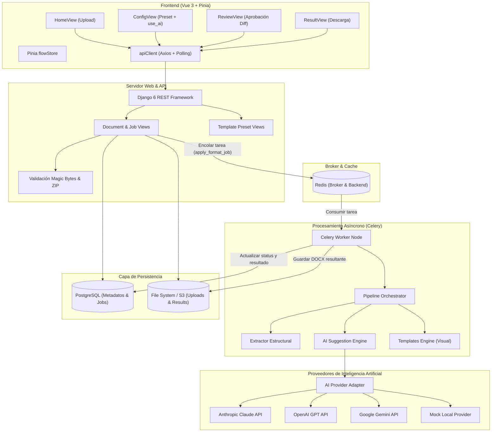
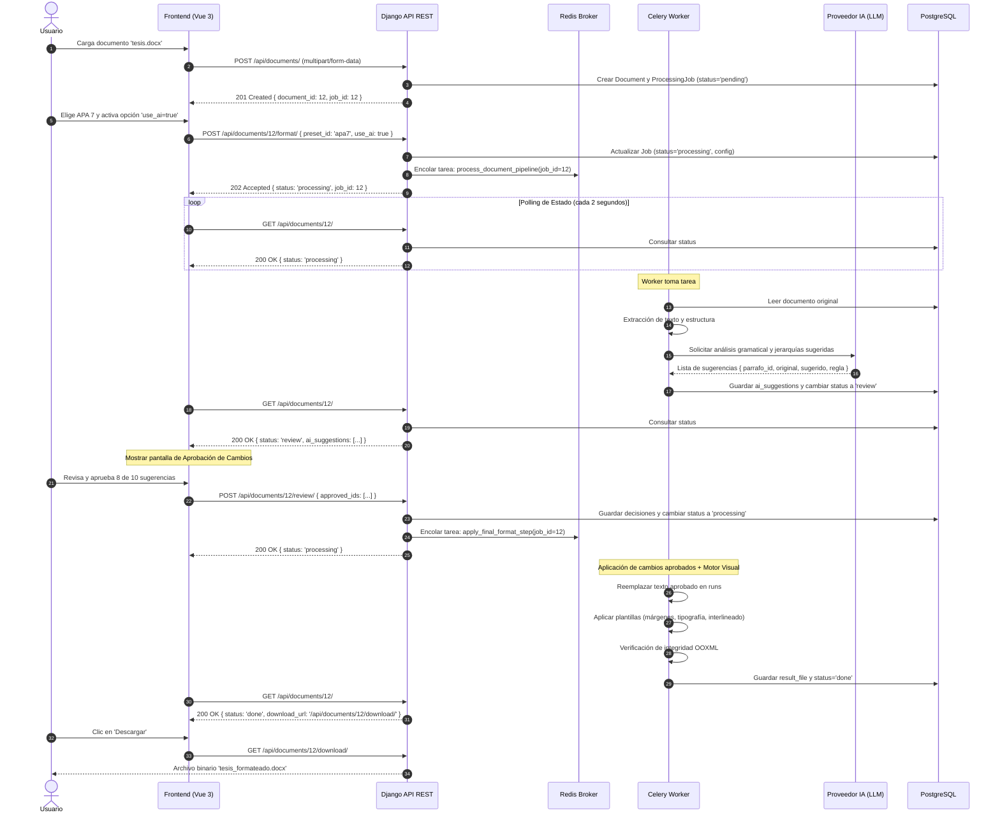
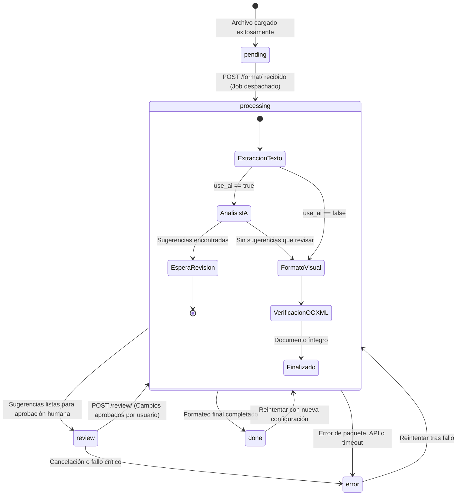

# Planificación Técnica y Arquitectura — Sprint 3: IA y Procesamiento Asíncrono

Este documento establece la arquitectura, diseño de software, diagramas de interacción, patrones de diseño y el plan de trabajo para el **Sprint 3** del proyecto PrettyDocs.

---

## 1. Definición del Problema

PrettyDocs superó con éxito la fase de formateo visual determinístico (márgenes, interlineado y tipografía sobre archivos `.docx` originales). Sin embargo, resolver únicamente el aspecto visual no satisface por completo la necesidad del usuario:
1. **Errores léxicos y gramaticales en el texto fuente:** Los documentos presentan faltas de ortografía, errores de concordancia y signos de puntuación inconsistentes.
2. **Desorganización jerárquica:** Títulos y subtítulos no siguen una estructura lógica de Word (frecuentemente párrafos normales escritos con mayúsculas sostenidas o negritas arbitrarias en lugar de estilos semánticos `Heading 1`, `Heading 2`).
3. **Restricción estricta de alcance:** El sistema **bajo ninguna circunstancia debe inventar contenido, eliminar párrafos clave ni modificar el significado de las ideas del autor**.
4. **Desafío de latencia I/O (Llamadas a LLMs):** Mientras que el formateo visual toma menos de 200 milisegundos, una llamada a un modelo de lenguaje (Claude, OpenAI o Gemini) para analizar y estructurar un documento completo toma entre **5 y 40 segundos**. Mantener una conexión HTTP síncrona abierta durante ese periodo causa caídas por timeout de proxies, browsers o balanceadores.
5. **Riesgo de alucinación y necesidad de supervisión:** La IA no debe aplicar cambios directamente al archivo final sin consentimiento. Es indispensable introducir una fase de **revisión y aprobación humana** (estado `review`).

---

## 2. Arquitectura del Sistema

### 2.1 Comparativa de Arquitectura: Sprint 2 vs. Sprint 3

| Aspecto | Sprint 2 (Implementación Actual) | Sprint 3 (Arquitectura Objetivo) |
| :--- | :--- | :--- |
| **Modelo de Ejecución** | Síncrono (bloqueante en hilo web de Django). | **Asíncrono desacoplado** mediante cola de mensajes. |
| **Colas y Tareas** | Inexistente (ejecución directa en la vista HTTP). | **Celery Worker** conectado a **Redis Broker**. |
| **Lógica de Formateo** | Únicamente reglas visuales (`templates_engine`). | **Pipeline Híbrido:** IA (`ai_engine`) + Plantilla Visual (`templates_engine`). |
| **Interacción con IA** | Deshabilitada (`use_ai = false`). | **Habilitada:** Integración con proveedores LLM mediante patrón Strategy. |
| **Ciclo de Vida del Job** | `pending` $\rightarrow$ `processing` $\rightarrow$ `done` / `error`. | `pending` $\rightarrow$ `processing` $\rightarrow$ **`review`** $\rightarrow$ `done` / `error`. |
| **Frontend Polling** | Espera activa de una sola petición HTTP `POST`. | **Polling periódico** (`GET /api/documents/{id}/`) o SSE con barra de progreso. |

---

### 2.2 Diagrama de Arquitectura de Servicios y Componentes



---

## 3. Diagramas de Flujo e Interacción

### 3.1 Diagrama de Secuencia: Flujo Asíncrono con IA y Estado de Revisión



---

### 3.2 Diagrama de Máquina de Estados del `ProcessingJob`



---

## 4. Patrones de Diseño a Implementar

Para garantizar mantenibilidad, testabilidad y escalabilidad en el Sprint 3, se adoptarán los siguientes patrones:

### 4.1 Strategy / Adapter Pattern para Proveedores de IA (`ai_engine`)
- **Problema:** El proyecto debe soportar APIs de OpenAI, Anthropic, Gemini o mocks locales para desarrollo y pruebas sin dependencias de red ni costos de tokens.
- **Implementación:**
  ```python
  # backend/documents/ai_engine/base.py
  from abc import ABC, abstractmethod

  class BaseAIProvider(ABC):
      @abstractmethod
      def analyze_text(self, paragraphs_payload: list[dict]) -> list[dict]:
          """Devuelve lista de sugerencias estructuradas."""
          pass
  ```
  Implementaciones concretas: `ClaudeProvider`, `OpenAIProvider`, `GeminiProvider` y `MockLocalProvider`. La selección se realiza por variable de entorno (`AI_PROVIDER=mock`).

### 4.2 Pipeline / Chain of Responsibility (`pipeline.py`)
- **Problema:** El proceso de transformación de un documento debe desacoplarse en fases independientes y auditables.
- **Implementación:**
  Cada paso del pipeline es una clase o función con contrato estándar:
  ```python
  def step(doc: Document, job: ProcessingJob, context: dict) -> Document:
  ```
  Cadena definida:
  1. `ValidationStep`: Comprobación previa de integridad de archivo.
  2. `StructureExtractionStep`: Identificación de párrafos, listas y tablas.
  3. `AISuggestionStep`: Generación de sugerencias ortográficas y jerárquicas (si `use_ai=True`).
  4. `HumanReviewGate`: Suspende el flujo al estado `review` si hay sugerencias pendientes.
  5. `TextReplacementStep`: Aplicación quirúrgica de textos aprobados conservando formato de run.
  6. `TemplateFormattingStep`: Aplicación de márgenes, tipografía e interlineado.
  7. `IntegrityVerificationStep`: Verificación de re-apertura OOXML.

### 4.3 Factory / Repository Pattern para Presets
- Centralizar la lectura de plantillas preconfiguradas (`apa7.json`, `reporte.json`) en un repositorio `PresetRepository` que devuelva objetos `TemplateConfig` enriquecidos con metadatos descriptivos para la API.

---

## 5. Riesgos Arquitectónicos a Futuro y Mitigaciones

| Riesgo Técnico | Impacto | Estrategia de Mitigación en Sprint 3 |
| :--- | :--- | :--- |
| **Límite de Tokens y Costos de LLM** | Documentos extensos (50-200 páginas) exceden el contexto del LLM y elevan exponencialmente costos. | **Chunking Semántico:** Enviar a la IA únicamente lotes de párrafos con contenido textual, omitiendo tablas numéricas masivas o imágenes. |
| **Fragmentación de Runs en Word al reemplazar texto** | Word fragmenta una frase en múltiples objetos `<w:r>` (runs). Si la IA corrige una palabra que cruza dos runs, un reemplazo ingenuo de texto borra negritas o enlaces. | **Reemplazo a nivel Run con Normalización:** Implementar algoritmo de mapeo de offset que identifique el run exacto donde reside el error o reconstruya el párrafo manteniendo las etiquetas de formato. |
| **Tolerancia a Caídas de Workers Celery** | Si el servidor se apaga mientras una tarea corre, el job queda congelado en `processing` permanentemente. | Configurar `task_acks_late=True` en Celery y añadir un comando de limpieza periódico (*Watchdog*) que pase a `error` los jobs con más de 10 minutos en `processing`. |
| **Privacidad de Documentos Confidenciales** | Documentos subidos por usuarios podrían contener información sensible (PII) enviada a APIs externas. | Añadir capa de anonimización básica de regex (e.g. enmascarar correos, tarjetas y DNIs) antes de enviar el payload al LLM. |
| **Almacenamiento en Disco Lleno** | Acumulación de copias `.docx` en `uploads/` y `results/`. | Tarea programada de Celery Beat que elimine archivos temporales con antigüedad mayor a 48 horas. |

---

## 6. Plan de Trabajo y Backlog Priorizado (Sprint 3)

```text
SPRINT 3 ROADMAP
├── Épica 1: Estabilización de Deuda Técnica (P0 - Prioridad Inmediata)
│   ├── [S3T01] Reparar colisión en urls.py y restaurar document_detail_view completa
│   ├── [S3T02] Mover y formatear catálogo de presets en /api/templates/ (con metadata)
│   ├── [S3T03] Resolver PRETTY-BUG-03: forzar run.font.size en typography.py
│   ├── [S3T04] Estandarizar respuestas de error en esquema { error: { code, message } }
│   └── [S3T05] Normalizar requirements.txt a UTF-8 y fijar django-cors-headers
│
├── Épica 2: Infraestructura de Procesamiento Asíncrono (P1)
│   ├── [S3T06] Configuración de Celery + Redis en Django settings y docker-compose básico
│   ├── [S3T07] Migración del pipeline de format_document_view a tarea asíncrona Celery
│   └── [S3T08] Actualización de vistas frontend para Polling periódico de estado
│
├── Épica 3: Motor de IA y Estrategia de Prompting (P1)
│   ├── [S3T09] Implementación de BaseAIProvider y MockLocalProvider
│   ├── [S3T10] Implementación de GeminiProvider / ClaudeProvider con prompts estrictos
│   └── [S3T11] Detección de jerarquías de encabezados y corrección ortográfica sin alteración
│
├── Épica 4: Experiencia de Usuario y Estado 'review' (P2)
│   ├── [S3T12] Endpoints para listar sugerencias y someter decisiones (POST /review/)
│   └── [S3T13] Vista de revisión interactiva en Frontend con comparador de cambios (diff)
│
└── Épica 5: Suite de Pruebas Automatizadas de Sprint 3 (P2)
    ├── [S3T14] Pruebas unitarias de los proveedores de IA con fixtures sintéticos
    └── [S3T15] Pruebas de integración E2E del flujo asíncrono completo con Celery en memoria
```

---

## 7. Criterios de Aceptación Globales del Sprint 3

1. **Estabilidad Base:** 100% de las pruebas en [`backend/tests/test_templates_engine.py`](file:///c:/Users/lartu/Documents/ITM/7%20TERM/GPS/projects/gps-textformatproject/backend/tests/test_templates_engine.py) y [`backend/tests/test_api.py`](file:///c:/Users/lartu/Documents/ITM/7%20TERM/GPS/projects/gps-textformatproject/backend/tests/test_api.py) ejecutándose y aprobadas en verde.
2. **Asincronía Real:** La petición `POST /api/documents/{id}/format/` responde en menos de 500 ms con código HTTP `202 Accepted` delegando el trabajo al worker.
3. **Control Humano:** Ninguna sugerencia de la IA es aplicada al documento definitivo sin haber sido explícitamente aprobada por el usuario en el estado `review`.
4. **Fidelidad Semántica:** Verificación automatizada de que el texto resultante no contenga información adicional no presente en el documento original.
